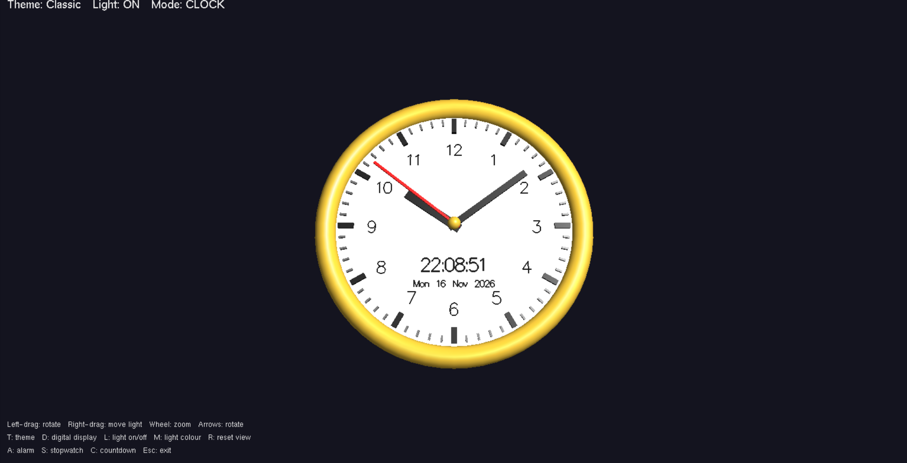
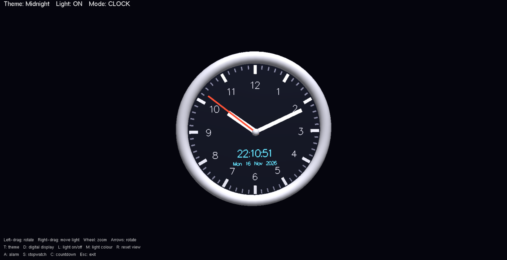
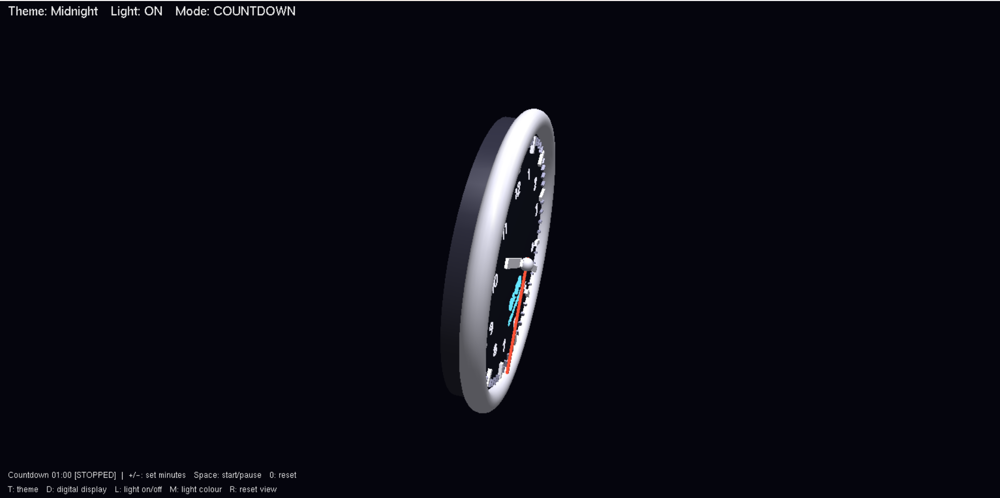
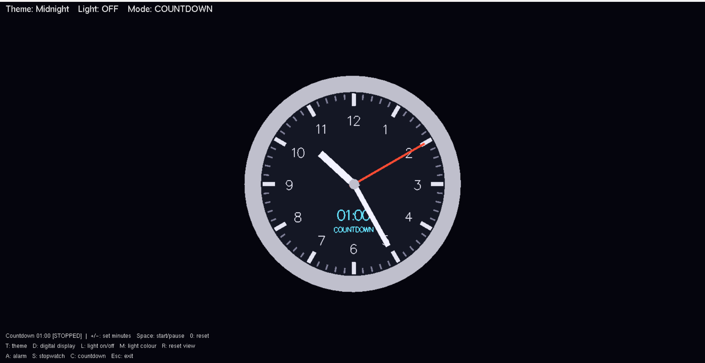
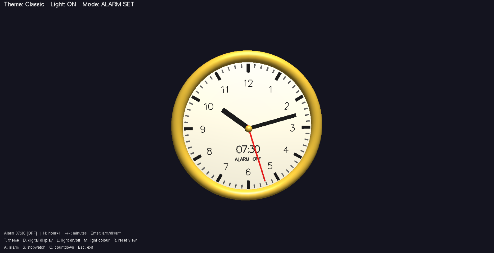
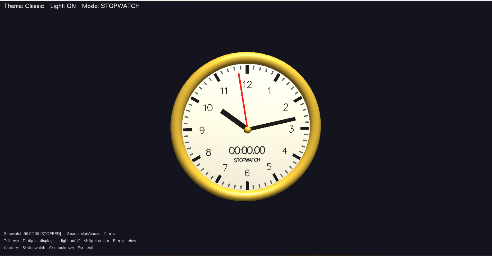

# Smart Interactive 3D Analog Clock with Lighting (OpenGL)

## 1. Project Title and Description

**Title:** Smart Interactive 3D Analog Clock Using OpenGL

**Description:**
This is a computer graphics mini project written in C++ using OpenGL (FreeGLUT) and compiled with MinGW on Windows. It renders a real-time 3D analog clock that follows the system time. The clock is lit by a movable point light with ambient, diffuse and specular components, so the metal body, golden bezel and hands show realistic shading and highlights.

On top of the basic clock, the project includes a smooth second hand, Arabic numerals with 60 tick marks, a digital time and date display, four colour themes, and alarm, stopwatch and countdown modes. The user can interact with the clock using the keyboard and mouse.

---

## 2. Project Screenshots

> Run the program, press `Print Screen` (or use the Snipping Tool), save the images in a `screenshots/` folder with the names below, and they will appear here.

| Screenshot | Description |
|---|---|s
|  | Classic theme with lighting ON |
|  | Midnight theme (press `T`) |
|  | Clock rotated with the mouse, showing 3D depth and shading |
|  | Lighting OFF (press `L`) for comparison |
|  | Alarm mode with the red alarm marker on the bezel |
|  | Stopwatch mode (press `S`) |

---

## 3. Installation Instructions

### Requirements
- Windows 10 or 11
- MinGW-w64 (g++ compiler)
- FreeGLUT library (OpenGL and GLU come with Windows and MinGW)

### Option A: Using MSYS2 (recommended)
1. Download and install MSYS2 from https://www.msys2.org
2. Open the **MSYS2 MinGW 64-bit** terminal and run:
   ```bash
   pacman -Syu
   pacman -S mingw-w64-x86_64-gcc mingw-w64-x86_64-freeglut
   ```
3. Add `C:\msys64\mingw64\bin` to your Windows `PATH`.
4. Check the installation:
   ```bash
   g++ --version
   ```

### Option B: Manual FreeGLUT setup (existing MinGW)
1. Download the FreeGLUT "MinGW package" (for example from Transmission Zero's FreeGLUT builds).
2. Copy the files into your MinGW folders:
   - `include/GL/*.h` to `<MinGW>/include/GL/`
   - `lib/libfreeglut.a` to `<MinGW>/lib/`
   - `bin/freeglut.dll` to the folder of your `.exe` (or `C:\Windows\System32`)

---

## 4. C++ Source Code Details

**File:** `clock_lighting.cpp` (single file, about 580 lines)

### Libraries used
| Header | Purpose |
|---|---|
| `<windows.h>` | `GetLocalTime` (time with milliseconds), `MessageBeep` (alarm sound) |
| `<GL/freeglut.h>` | Window, input callbacks, solid shapes, stroke and bitmap text |
| `<cmath>`, `<cstdio>`, `<cstdlib>`, `<cctype>`, `<cstring>` | Maths, string formatting and utilities |

### Code structure
| Section | Functions | What it does |
|---|---|---|
| State and themes | `struct Theme`, `themes[]` | Stores colours for 4 themes and the mode, alarm, stopwatch and countdown variables |
| Lighting | `setupLight()`, `drawLightMarker()` | Sets up `GL_LIGHT0` (positional light) and draws a small sphere at the light position |
| Clock parts | `drawClockBody()`, `drawTicks()`, `drawNumerals()`, `drawHand()`, `drawAlarmMarker()` | Builds the body, face, bezel, ticks, numerals, hands and alarm marker |
| Text | `strokeText()`, `buildDisplayText()`, `drawDigital()` | Draws numerals and the digital display on the face |
| HUD overlay | `beginHUD()`, `drawHUD()`, `endHUD()` | 2D on-screen text (mode, hints) using an orthographic projection |
| Rendering | `display()`, `reshape()` | Main draw loop and perspective projection |
| Logic | `update()`, `timer()` | Alarm check, countdown update, ringing sound, redraw every 16 ms |
| Input | `keyboard()`, `special()`, `mouse()`, `motion()`, `wheel()` | Keyboard, arrow-key, mouse-drag and scroll handling |
| Setup | `init()`, `main()` | Enables depth test, lighting and materials; registers callbacks |

### Key OpenGL functions and concepts
- **Lighting:** `glLightfv`, `glMaterialfv`, `glColorMaterial`, `GL_SHININESS`, `GL_NORMALIZE`
- **3D shapes:** `gluCylinder`, `gluDisk`, `glutSolidTorus`, `glutSolidCube`, `glutSolidSphere`
- **Transformations:** `glTranslatef`, `glRotatef`, `glScalef`, `glPushMatrix` / `glPopMatrix`
- **Camera:** `gluPerspective`, `gluLookAt`
- **Depth and animation:** `GL_DEPTH_TEST`, double buffering, `glutTimerFunc`
- **Text:** `glutStrokeCharacter` (on the face), `glutBitmapString` (HUD)

### Maths used
- Hand angles: hour = 30° per hour, minute and second = 6° per unit
- Smooth second hand: `seconds + milliseconds / 1000`
- Numeral positions: `x = r·sin θ`, `y = r·cos θ`

---

## 5. Features and Objectives

### Features
1. Real-time analog clock using system time
2. Smooth-moving second hand
3. Arabic numerals (1 to 12) and 60 tick marks
4. Digital time and date/day display on the clock face
5. Four themes: Classic, Midnight, Ocean, Neon
6. Alarm mode with a visual marker, screen flashing and a beep
7. Stopwatch mode (start, pause, reset)
8. Countdown timer mode with adjustable minutes
9. Movable coloured point light (white, warm, cool) with specular highlights
10. Mouse rotate, light movement and zoom, plus keyboard controls

### Objectives
- To understand and apply the OpenGL lighting model (ambient, diffuse and specular)
- To build a 3D object from basic primitives using transformations
- To practise animation using timer callbacks and double buffering
- To handle keyboard and mouse input interactively
- To combine graphics, animation, user interaction and real-time data in one project

### Controls
| Key / Mouse | Action |
|---|---|
| `T` | Change theme |
| `D` | Toggle digital display |
| `A` | Alarm mode (`H` hour+1, `+`/`-` minutes, `Enter` arm or disarm) |
| `S` | Stopwatch mode (`Space` start/pause, `0` reset) |
| `C` | Countdown mode (`+`/`-` minutes, `Space` start/pause, `0` reset) |
| `L` | Light on/off |
| `M` | Change light colour |
| `R` | Reset view and light |
| Arrow keys | Rotate the clock |
| Left-drag | Rotate the clock |
| Right-drag | Move the light |
| Mouse wheel | Zoom |
| Any key | Stop a ringing alarm |
| `Esc` | Exit |

---

## 6. Compilation and Execution Commands

**Compile (FreeGLUT on PATH or in MinGW folders):**
```bash
g++ clock_lighting.cpp -o clock_lighting -lfreeglut -lopengl32 -lglu32
```

**Compile with manual paths (if FreeGLUT is in a custom folder):**
```bash
g++ clock_lighting.cpp -o clock_lighting -I"C:/freeglut/include" -L"C:/freeglut/lib" -lfreeglut -lopengl32 -lglu32
```

**Run:**
```bash
clock_lighting.exe
```

**Troubleshooting:**
| Problem | Fix |
|---|---|
| `cannot find -lfreeglut` | Check that `libfreeglut.a` is in a `lib` folder, or add `-L` with its path |
| `GL/freeglut.h: No such file` | Add `-I` with the include folder |
| Program closes at once or `freeglut.dll` missing | Copy `freeglut.dll` next to the `.exe` |
| Alarm has no sound | Turn on Windows system sounds (the screen still flashes) |

---

## 7. Developer Information

| Field | Details |
|---|---|
| Name | *[Your Name]* |
| Roll No. / ID | *[Your Roll Number]* |
| Course | Computer Graphics (Mini Project) |
| Department / Year | *[Branch, Year]* |
| College | *[College Name]* |
| Guide / Faculty | *[Guide Name]* |
| Email | *[Your Email]* |
| GitHub | *[Your GitHub Link]* |

**Tools:** C++, OpenGL, FreeGLUT, MinGW-w64, Windows

---

## 8. Future Improvements

- Texture-mapped clock face and wood or metal textures
- Real shadows and multiple light sources
- Sound effects for ticking and a custom alarm tone
- Multiple alarms and a saved alarm list
- World clock with different time zones
- Pendulum animation for a grandfather-clock style
- Lap times in the stopwatch
- Day/night theme that changes automatically with the time
- Cross-platform support (Linux and macOS) by replacing the Windows-specific calls
- Modern OpenGL (shaders, VBOs) instead of the fixed pipeline
